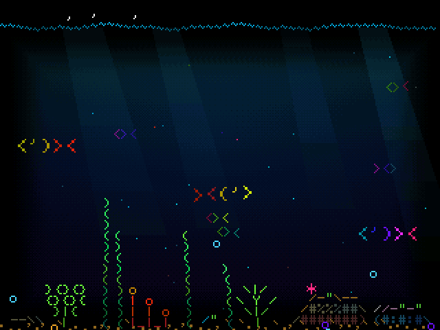
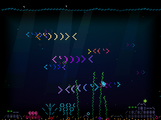

# Ghost Aquarium

**ASCII fish that swim in mid-air.** Ghost Aquarium is a desk aquarium built on an ESP32-S3. A small color screen is hidden in a 3D-printed base, and a clear sheet at 45° reflects it toward the viewer (the *Pepper's Ghost* illusion). Schools of ASCII fish, swaying seaweed and rising bubbles appear to float inside an empty box. It's designed to run 24/7 as a desk piece.

> **Status: design complete, build starting (November 2026).** This README describes the target. The [roadmap](docs/ROADMAP.md) tracks what is actually finished, and a box is ticked only when the work is merged and demonstrated.

---



*Rendered by the firmware's own C++ renderer, frame for frame what the ESP32 draws (`make gif`). Shown un-mirrored; on the device the panel mirrors it for the reflector.*

## How it works

```
   eye ───────────────►   ><((('>   ghost image floats behind the sheet
                      ╲
                       ╲   clear sheet at 45°
                        ╲
   ┌──────────────────────────────┐
   │  ▓▓▓▓  screen, face up  ▓▓▓▓  │   hidden in the 3D-printed base
   └──────────────────────────────┘
```

Light from the screen reflects off the angled sheet toward your eye. Black pixels reflect nothing, so only the fish are visible and they seem to hang in the air. The reflection is mirrored left to right, and the display controller flips it back in hardware at no CPU cost.

### Runs on the real firmware

The actual firmware booted on a simulated ESP32-S3 + ILI9341 in [Wokwi](https://wokwi.com) (`make sim`):



## Engineering highlights

| Area | Approach |
|---|---|
| **Legible, calm motion** | Fish are rigid ASCII rows on float positions, steered by wander, schooling, wall and depth forces. Reversal is always an animated flip-turn, never a bent or folded body. Fish swim out of view and return a few seconds later. Every rule was measured in the prototype ([ADR 0009](docs/adr/0009-motion-model.md)). |
| **Designed against the real hardware** | The browser prototype's default view is a software renderer that reproduces the device exactly: an RGB565 framebuffer, a 5×7 bitmap font, whole-pixel positions and 30 fps. It is the reference for the C++ renderer ([ADR 0008](docs/adr/0008-device-render-pipeline-and-budgets.md)). |
| **No flicker or tearing** | Each frame is rebuilt off-screen from a pre-rendered, Bayer-dithered background, then pushed whole. The budget is about 290 glyph blits per frame against a 31 ms SPI push ([DESIGN §8](docs/DESIGN.md#8-performance-budget-adr-0008)). |
| **Made for the reflector** | Black is invisible on the glass, so the water glow fades to pure black at every screen edge and no effect leaves gray residue. The panel mirrors the image in hardware. |
| **Stable simulation** | A fixed 60 Hz timestep, separate from the render rate, with capped catch-up steps. Deterministic for a given seed. |
| **Testable firmware** | Simulation (`lib/tanksim`) and rendering (`lib/tankrender`) are hardware-free C++ libraries, unit-tested on a laptop (soak tests, determinism, invariants) and run in CI on every push. |
| **Built for 24/7** | Task watchdog, fixed-capacity pools (no heap allocation per frame), deterministic seeded randomness. |

## Tech stack

C++17 · ESP32-S3 (Arduino on ESP-IDF) · [LovyanGFX](https://github.com/lovyan03/LovyanGFX) · PlatformIO · Unity test framework · Wokwi · GitHub Actions · CAD + FDM 3D printing

## Repository layout (target)

```
lib/tanksim/        Hardware-free simulation: fish, schooling, coming & going, ambient life, seabed
lib/tankrender/     Hardware-free RGB565 framebuffer renderer (port of the prototype's device preview)
src/                Firmware: display config, memory, 60 Hz stepper, push to the panel
test/               Unit tests for both libraries (run on the laptop and in CI)
prototype/          Browser tuner: device-accurate preview + sliders + "Copy as C++"
hardware/           CAD for the base, reflector dimensions, wiring
docs/               Design spec, roadmap, ADRs, implementation plans
```

## Build and run

Every workflow is one command (`make help` lists them). They're also VS Code tasks (⇧⌘B runs `make check`).

| Command | What it does |
|---|---|
| `make setup` | Installs PlatformIO and checks the Wokwi simulator setup |
| `make cad` | Regenerates the 3D-printable enclosure (STLs + cross-sections) from parametric code |
| `make gif` | Renders the README demo GIF with the firmware renderer |
| `make check` | Laptop tests, firmware build and a rendered snapshot frame: everything that needs no hardware |
| `make prototype` | Opens the browser tuner (device-accurate preview, sliders, "Copy as C++") |
| `make sim` | Boots the real firmware in Wokwi headlessly and checks it reports frame stats (needs a free `WOKWI_CLI_TOKEN`) |
| `make flash monitor` | Uploads to a connected ESP32-S3 and shows its fps/render/push stats |

CI runs the tests and the firmware build on every push, plus the Wokwi boot check when the repo has a `WOKWI_CLI_TOKEN` secret.

## Documentation

| Doc | What's in it |
|---|---|
| [Design spec](docs/DESIGN.md) | What the tank does and looks like: scene, motion rules, tuning values, hardware, constraints |
| [Roadmap](docs/ROADMAP.md) | Phases, hardware milestones, current progress |
| [Parts list](docs/BUY.md) | What to buy for the hardware build, with links |
| [v2 spec](docs/specs/v2-interaction.md) | Feed button, living tank, phone control, weather link |
| [Architecture decisions](docs/adr/) | Why each technical choice was made, and the alternatives that were rejected |
| [Phase 0 plan](docs/plans/2026-11-14-phase0-sim-and-renderer.md) | Task-by-task implementation plan for the simulation and renderer |

## Roadmap at a glance

- [ ] **Phase 0: Simulate.** Browser tuning prototype, tested simulation library, renderer running in Wokwi
- [ ] **Phase 1: Ghost tank (v1).** Real hardware, cardboard optics test, 3D-printed base, demo video
- [ ] **Phase 2: Interaction (v2).** Feed button, living tank with saved state, phone control page, weather and sunset link

## Credits

Inspired by a maker video by `_re_pete` on TikTok. This is an independent build with its own code and design.

## License

[MIT](LICENSE)
