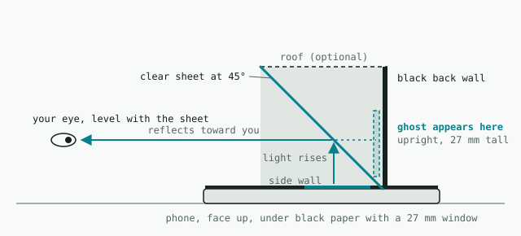
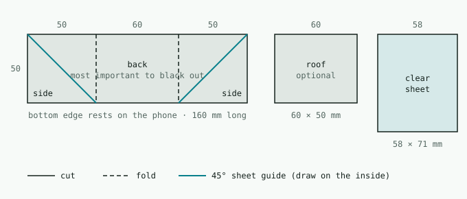
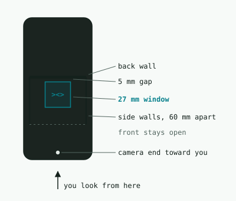

# Cardboard ghost test

A 30-minute, zero-cost check before buying the display. Build a small cardboard hood, put your phone under it, and see what a **27 × 27 mm** ghost tank (the 1.5" 128×128 OLED's visible area) looks like on your desk.

> The interactive version, with a calibrated phone **test screen** of ASCII fish, is [`optics-test.html`](optics-test.html). GitHub shows that file as code, so open it from a browser.

## How the trick works

The screen lies face-up. A clear sheet above it, tilted at 45°, reflects the screen's light toward your eye. You see the fish standing upright behind the sheet, in front of a black wall. Black pixels give off no light, so only the fish show.

The ghost forms on the line where the sheet meets the back wall. Window light nearer to you appears higher in the ghost, so **the top of the tank image must point toward you**.

## What this test answers

| Check | Question |
|---|---|
| Size | Is a 27 × 27 mm ghost big enough on your desk? |
| Brightness | Can you see it clearly in a dim room? |
| Double image | Does the sheet's thickness show two overlapping copies? |
| Mirroring | Does text read correctly in the reflection? |

If your phone has an OLED screen (most iPhones from the X onward, except the XR, 11 and SE), its black is true black, like the 1.5" OLED. This is then a close preview of the real thing.

## What you need

- **Thin cardboard:** a cereal box or shipping-box side, at least 160 × 110 mm
- **Black:** black paper, or a black marker or matte paint. Avoid anything glossy
- **Clear sheet:** as thin and flat as possible: a CD case lid (about 1 mm), clear packaging plastic, or a transparency sheet. Picture-frame glass works but doubles more
- **Tools:** ruler, scissors or a craft knife, tape
- **Your phone**

## Build it

### 1. Cut and fold the hood

Cut one strip of cardboard **160 × 50 mm**. Fold it at 50 mm and 110 mm into a U: side, back, side. Cut the **58 × 71 mm** clear sheet and the optional **60 × 50 mm** roof too.

Each side panel is a 50 mm square, so its corner-to-corner diagonal is exactly 45°. The guide runs from the bottom corner at the back fold to the top corner at the front.

### 2. Black out the inside

Color every inside face black, the back wall most of all. Any lit or shiny surface behind the sheet shows up in the reflection. Draw the two 45° guides after the black, with a pencil or a silver pen.

### 3. Tape in the sheet

- Peel any protective film off and wipe off fingerprints.
- Rest the sheet on the two guides. Its bottom edge touches the bottom of the back wall, and its top edge reaches the top front corners.
- Tape along the outer edges only. Keep tape off the middle, where you look through.

Trim the sheet if it bows. It has to lie flat, or the ghost warps.

### 4. Add the roof (optional)

Tape it on top, black side down. It blocks ceiling light from washing out the ghost.

### 5. Set up your phone

Brightness all the way up, Auto-Lock set to Never, Do Not Disturb on. Open the test screen (`optics-test.html`) and calibrate it once against a ruler. Or show any bright image on a black background, about 27 mm across.

### 6. Cut the mask and lay the phone down

Cut black paper the size of your phone, with a **27 × 27 mm** window in the middle. Lay the phone face-up with its **camera end toward you**. Lay the paper so the window sits over the tank, and tape the corners. The mask hides the rest of the screen, so only the OLED-sized square of light reaches the sheet.

### 7. Place the hood

Open side toward you. Leave about **5 mm** between the back wall and the window's far edge, and center the window between the side walls.

### 8. Look

Dim the room. Lower your head until your eye is level with the middle of the sheet, about 30–50 cm away, and look through the open front. The fish should hang in the air at the back wall.

## If something looks wrong

| What you see | Fix |
|---|---|
| Text reads backwards | Switch the mirroring (the test screen has a **Mirror** button) |
| Tank is upside down (sand on top) | Turn the phone around, then re-check the text |
| Two overlapping copies of each fish | The sheet is too thick. Try thinner plastic. The real build uses 0.76 mm PETG |
| Ghost is faint | Darken the room, add the roof, maximum brightness |
| A gray square around the fish | Your phone has an LCD, which can't show true black. This is the glow the OLED removes |
| Top or bottom of the tank is cut off | Slide the hood so the whole window sits between the back wall and the front edge |
| You see the phone, not a ghost | Your eye is too high. Look straight through the front at sheet height |

## Record the result

Note whether 27 mm feels big enough, how bright the ghost is in a dim room, whether there's a double image, and which mirror setting read correctly. That confirms or overturns the display decision before ordering parts ([ROADMAP](ROADMAP.md), Phase 1).
