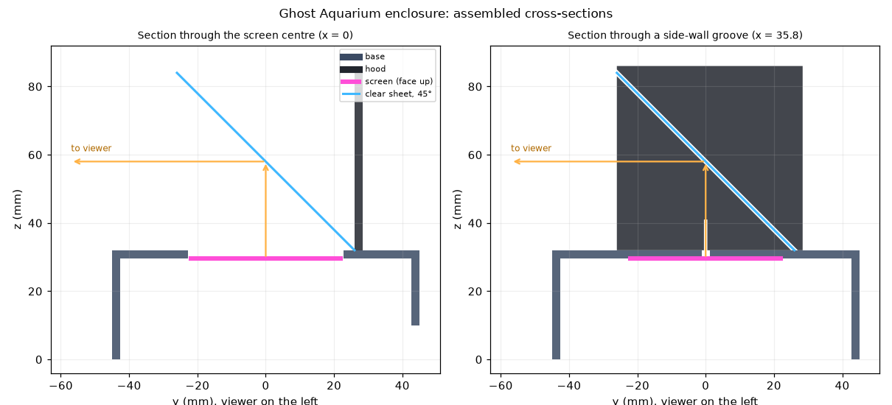

# Enclosure (3D-printed)

Parametric code-CAD in [`ghost_base.py`](ghost_base.py) (Python + [manifold3d](https://github.com/elalish/manifold)). Edit the parameters at the top of the file, then regenerate with `make cad`. The STLs for the default dimensions are already in [`out/`](out/).

## Parts

| File | What | Print orientation |
|---|---|---|
| [`out/base.stl`](out/base.stl) | Screen box (110 × 90 × 32 mm): window over the display, 4 display bosses, USB-C notch | **Upside down** (top plate on the bed). No supports needed |
| [`out/hood.stl`](out/hood.stl) | Two side walls with 45° grooves for the sheet, plus a dark back wall (78 × 54 × 54 mm) | **Standing up**, as shown. A 45° groove prints without supports |

Suggested settings: PLA or PETG, 0.2 mm layers, 3 walls, 15% infill. Print in **matte black**: anything lit or shiny inside the box shows up on the reflector (DESIGN §3).

## Other parts

- **Clear sheet:** cut to **73 × 74 mm** from 1 mm clear PETG or acrylic (`make cad` prints the exact size for your parameters). Thinner means less double image. Optionally add beam-splitter film.
- **Screws:** 4 × M3 × 6 self-tapping (display to bosses), 2 × M3 × 10 (from inside the base, up into the hood).

## Assembly

1. **Measure first.** Check the display's PCB size, visible area, mounting-hole inset and the glass height above the PCB with calipers. Update `DISP_*` in `ghost_base.py`, then run `make cad`.
2. Screw the display to the bosses, face up, with the glass against the underside of the window.
3. Wire the ESP32-S3 (pins: [DESIGN §9](../docs/DESIGN.md#pin-map-esp32-s3)) and lay it on the desk inside the base, with the USB-C port at the notch.
4. Screw the hood onto the top from inside the base (2 × M3).
5. Slide the sheet into the grooves. Its top edge leans toward the viewer.
6. View from the front, slightly above the base, in a dim room. If the image is flipped the wrong way, build with `-DGHOST_MIRROR=0` or change the rotation (ADR 0003).

Tune the angle first with the cardboard test in the [roadmap](../docs/ROADMAP.md) before printing. If your reflector needs a different angle or size, change `HOOD_*` / `SHEET_T` and regenerate.
